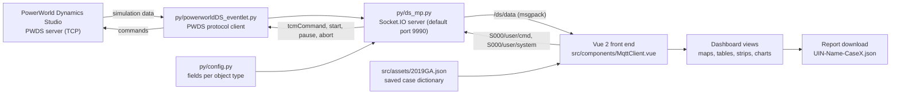

# powerweb-rs

## Project setup
```
npm install
```

### Compiles and hot-reloads for development
```
npm run serve
```

### Compiles and minifies for production
```
npm run build
```

### Customize configuration
See [Configuration Reference](https://cli.vuejs.org/config/).

<!-- Sections below were added on 2026-09-27. The original text above is unchanged. -->

## Overview

This repository holds GridVerse, a web and desktop front end for live PowerWorld Dynamics Studio (PWDS) simulations, written by Zeyu Mao in 2021-22. The text above is the Vue CLI project template. The app was first called PowerWeb (`powerweb-electron` in the first commit's `package.json`) and is `gridverse` 2.4.0 in the current `package.json`. A Python backend in `py/` connects to a PWDS server over the PWDS TCP protocol, registers a data package, and pushes live values to every connected browser over Socket.IO. Users log in with a name and the address and port of the backend, watch the case on maps, tables, strip charts and generation charts, send device commands (for example open or close a branch, or set generator MW), and start, pause, continue or abort the simulation. A report dialog lets the user download a JSON report of the session.

## How it works



1. `py/ds_mp.py` opens a TCP connection to PWDS, requests the case dictionary (`tcmDictionary`), and registers data package 1000 (`tcmGetData`). The package holds the fields listed in `py/config.py` for all areas and for the buses, substations, generators, loads and shunts in area number 2, plus the branches and transformers connected to those buses.
2. Once a second it requests that package (`tcmGetDataByID`), rounds the values to two decimals, and emits them on `/ds/data` as msgpack.
3. The front end connects with `socket.io-client`, decodes the messages, and stores them in the Vuex store (`src/store.js`). The views read from the store. The static case layout (names, limits, substation coordinates, generator costs) comes from `src/assets/2019GA.json` and `src/assets/2019GAR.json`, which are bundled into the build.
4. Commands from the UI go out on `S000/user/cmd` and `S000/user/system`. The backend checks device commands against its command list and forwards them to PWDS (`tcmCommand`, start, pause, continue, abort, run to a given second). PWDS state changes come back on `/ds/system`, and command confirmations on `/ds/note`.

## Repository layout

| Folder | What it contains | Main contributor (git history) | Start here |
|---|---|---|---|
| `src/` | Vue 2 + Vuetify front end: login page, dashboard, views, Vuex store (`src/store.js`), bundled case data in `src/assets/` | Zeyu Mao | `src/views/Login.vue`, `src/components/Dashboard.vue`, `src/components/MqttClient.vue` |
| [`py/`](py/README.md) | Python backend (PWDS protocol client and Socket.IO server), test client, build scripts, committed Windows builds | Zeyu Mao | `py/ds_mp.py` |
| [`resources/`](resources/README.md) | Neutralino desktop build of the front end (minified, 2021-12-05) | Zeyu Mao | `resources/index.html` |
| `src-tauri/` | Tauri (Rust) desktop shell; bundles `../pydist/ds_client` as an external binary | Zeyu Mao | `src-tauri/tauri.conf.json` |
| `public/` | HTML template, icons and web manifest used by Vue CLI | Zeyu Mao | `public/index.html` |
| `dist/` | Production web build from 2022-08-17, built for the `/GridUniverse/` path (GitHub Pages) | Zeyu Mao | `dist/index.html` |
| `bin/` | Neutralino runtime binaries (Windows, Linux, macOS) and `WebView2Loader.dll` | Zeyu Mao | none |

`src/main.js` imports `./store` and `./router`, which resolve to `src/store.js` and `src/router.js`. The `src/store/` and `src/router/` folders are not used. Other saved case dictionaries in `src/assets/` (150-bus, 200-bus and further 2,000-bus variants) and `src/assets/USA.json` are not imported by the current code.

Root files:

| File | What it does |
|---|---|
| `package.json`, `package-lock.json` | npm scripts and front-end dependencies |
| `vue.config.js`, `babel.config.js`, `postcss.config.js` | Vue CLI 4 build settings (production `publicPath` is `/GridUniverse/`) |
| `neutralino.config.json` | Neutralino app settings (window, `/resources/` path, binary version 3.3.0) |
| `move-binary.js` | Renames `pydist/ds_client(.exe)` with the Rust target triple; run by the Tauri scripts |
| `ds_client.exe` | Backend executable started by the Neutralino build. It is byte-identical to the 2021-12-05 build of `py/dist/ds_mp.exe` (the Socket.IO backend). |
| `ds_client.spec` | PyInstaller spec for `py\ds_client.py` |
| `vite.config.js`, `index.html` | Vite setup from 2021-11; no npm script uses it and Vite is not in `package.json` |
| `neutralinojs.log` | Neutralino runtime log from 2021-12-05 |

## Setup

1. Access to a PowerWorld Dynamics Studio (PWDS) server with a case loaded (PowerWorld licence required), reachable over TCP from the machine that runs the backend.
2. Python 3.9 for the backend (the committed builds bundle Python 3.9.7). From the repository root:
   ```
   python -m venv .venv
   .venv\Scripts\activate
   pip install -r requirements.txt
   ```
3. Node.js and npm for the front end. The build uses Vue CLI 4 and webpack 4, so use Node.js 16, or set `NODE_OPTIONS=--openssl-legacy-provider` on Node.js 17 or newer. Then run `npm install` in the repository root.
4. The one-line view (`src/components/OneLine.vue`) loads Mapbox tiles. Supply your own Mapbox access token in that file.
5. Optional: the Neutralino CLI (`npm install -g @neutralinojs/neu`) to run the desktop build in `resources/`.
6. The backend and front end need no path edits. `py/build.py` and `py/gzip_json.py` contain hard-coded `C:\Users\test\NodeProjects\PowerWeb-RS-electron\...` paths; edit them before using those two scripts.

## Running

1. Start PWDS and note the host and port it listens on. Start it before the backend: `ds_mp.py` connects once at start-up and does not retry if that first connection fails.
2. Start the backend from `py/`:
   ```
   cd py
   python ds_mp.py <PWDS host> <PWDS port> <server port>
   ```
   Example: `python ds_mp.py localhost 5557 9990`. Give all three arguments; with fewer, the script uses its built-in defaults (`192.168.1.221`, `5557`, `9990`). To rebuild `config.py` from `datafields.json` first, set `ENV=DEV` (`set ENV=DEV` in cmd, `$env:ENV="DEV"` in PowerShell) before starting.
3. Start the front end from the repository root:
   ```
   npm run serve
   ```
   Open the URL it prints (Vue CLI uses port 8080 by default).
4. On the login page enter a name, the IP address of the machine running `ds_mp.py` (default `localhost`), and the Server Port (default 9990, as in the example). The Simulation ID field is commented out in `src/views/Login.vue`, so the ID is always `000`, which matches the `S000` prefix fixed in `ds_mp.py`. The "Connect to DS" checkbox is disabled, so the DS Port field stays hidden.
5. For a production web build run `npm run build`. It writes `dist/` for the `/GridUniverse/` path.
6. For the Neutralino desktop build run `neu run` (or `npm run neu:serve`) from the repository root. See [`resources/README.md`](resources/README.md).

## Inputs and outputs

- Input: a live PWDS simulation over TCP (host and port given to `ds_mp.py`).
- Input: `py/config.py`, with the same content as `py/datafields.json` and `src/assets/datafields.json`: the fields requested for areas, substations, buses, generators, loads, shunts, branches and transformers.
- Input: `src/assets/2019GA.json`, a saved PWDS case dictionary bundled into the front end: 2 areas ("Rest of Texas" and "South Texas"), 2,000 buses, 1,250 substations with latitude and longitude, 511 generators with cost data, 1,360 loads, 160 shunts, 2,345 branches and 861 transformers. `src/assets/2019GAR.json` is the area 2 subset (166 buses). To use another case, change the imports at the top of `src/store.js` and check the backend's area filter.
- Output: live values, notifications and charts in the browser; commands sent to PWDS.
- Output: a JSON report downloaded from the report dialog (`UIN-Name-CaseX.json`).
- Output: `py/config.py` is rewritten when `ENV=DEV` is set.

## Known issues

- `npm run electron:serve`, `electron:build`, `tauri:serve` and `tauri:build` call Vue CLI plugins that are not in `package.json` (`vue-cli-plugin-electron-builder`, `vue-cli-plugin-tauri`), so they fail as written. The Tauri scripts also need Rust and a `pydist/ds_client` build.
- `npm run python:build` fails: PyInstaller rejects `--add-data ./py/datafields.json` without a destination ("Wrong syntax, should be --add-data=SOURCE:DEST"). The script also packages `py/ds_client.py`, the older ZeroMQ backend, which the current Socket.IO front end cannot talk to. The Electron launcher (`src/background.js`) and the Tauri config both expect this build.
- Both backends request data only for area number 2 (fixed in `setup_dictionary_data`). With a case that has no area 2, the data package holds only area-level values.
- `py/build.py` and `py/gzip_json.py` use hard-coded `C:\Users\test\...` paths.

## Contributors

From the git history:

- Zeyu Mao: 79 commits

## Status

- First commit 2021-11-08; last code commit 2022-08-17 (a production build in `dist/` and the `/GridUniverse/` `publicPath` in `vue.config.js`, for GitHub Pages).
- Front end (`src/`): last changed 2022-04-08. Backend source (`py/ds_mp.py`): last changed 2021-12-05; the committed `py/dist/ds_mp.exe` was rebuilt on 2022-03-16.
- Earlier packaging work, not changed since: Tauri (`src-tauri/`, 2021-11-19 to 2021-11-25), Electron (`src/background.js`, last changed 2021-11-26), Neutralino (`resources/`, `bin/`, 2021-11-30 to 2021-12-05), and the ZeroMQ backend (`py/ds_client.py`, last changed 2021-11-16).
- The remote also has the branches `tamu`, `gh-pages`, `neutralino`, `electron`, `socketio`, `neutrino` and `vuetify2`.
